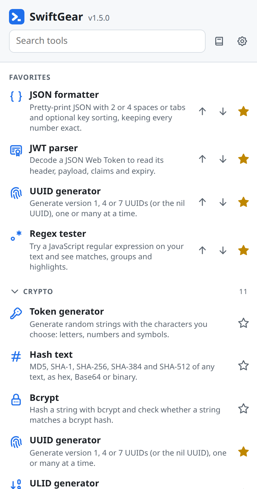

# SwiftGear

**85 offline developer utilities in your browser's side panel** (Chrome, Edge, Brave, Vivaldi, Opera and other Chromium browsers). JSON, Base64, JWT, UUIDs, hashes, regex, QR codes, cron, SQL, subnets and much more, one click or one shortcut away.

- **Version:** 1.5.2 · [release notes](https://github.com/DoggByte/SwiftGear/releases/tag/v1.5.2) · [CHANGELOG](CHANGELOG.md)
- **Author:** DoggByte · [doggbyte.com](https://doggbyte.com) · [doggbyte@bert2go.com](mailto:doggbyte@bert2go.com)
- **Works in:** any Chromium-based browser that runs Chrome extensions (version 116 or newer). Firefox and Safari are not supported.
- **Privacy:** no account, no server, no analytics, no access to the pages you visit. Everything you type stays in your browser.
- **License:** GNU General Public License v3.0, see [LICENSE](LICENSE).

  <picture>
    <source media="(prefers-color-scheme: dark)" srcset="images/panel-dark.png">
    
  </picture>

## What it does

- **Opens beside the page you are on.** Click the toolbar button, or press <kbd>Alt</kbd>+<kbd>Shift</kbd>+<kbd>D</kbd>, and the side panel opens with the search box ready.
- **Finds a tool fast.** Type a few letters (`jwt`, `uuid`, `cron`) and press <kbd>Enter</kbd>, or browse the ten categories.
- **Keeps your favorites on top.** Star the tools you use most and put them in your own order.
- **Works from any page.** Select text, right-click, choose **SwiftGear** and one of Format JSON, Decode Base64, Encode Base64, Decode JWT, Decode URL, Hash text, Convert timestamp, Make QR code, Format SQL, Explain cron expression, Format XML or Prettify YAML. The panel opens on that tool with your selection filled in.
- **Explains itself.** A full User Guide is built in (the book button beside the search box), and every tool has a help button and a **How to use, examples** box with a real example.
- **Remembers what matters.** Many tools keep your last options. Settings lets you hide the descriptions, the icons or the How to use box.
- **Stays offline.** Every tool, including the heavy ones, is included in the download. The only network request SwiftGear can make is **Check for updates** in Settings, which asks GitHub for the newest release when you press it, never on its own, and sends nothing about you.

## The tools

- **Crypto** (11): Token generator, Hash text, Bcrypt, UUID generator, ULID generator, Encrypt / decrypt text, BIP39 passphrase generator, HMAC generator, RSA key pair generator, Password strength analyser, PDF signature checker.
- **Converter** (20): Date-time converter, Integer base converter, Roman numeral converter, Base64 string converter, Base64 file converter, Color converter, Case converter, Text to NATO alphabet, Text to ASCII binary, Text to Unicode, YAML to JSON converter, YAML to TOML converter, JSON to YAML converter, JSON to TOML converter, List converter, TOML to JSON converter, TOML to YAML converter, XML to JSON converter, JSON to XML converter, Markdown to HTML converter.
- **Web** (16): URL encoder and decoder, HTML entities, URL parser, Device information, Basic auth generator, Meta tag generator, OTP code generator, MIME types, JWT parser, Keycode info, Slugify string, HTML WYSIWYG editor, User agent parser, HTTP status codes, JSON diff, Outlook SafeLink decoder.
- **Images and videos** (3): QR code generator, WiFi QR code generator, SVG placeholder generator.
- **Development** (14): Git cheatsheet, Random port generator, Crontab generator, JSON formatter, JSON minifier, JSON to CSV, SQL prettify and format, Chmod calculator, Docker run to docker-compose converter, XML formatter, YAML prettify and validator, Email normalizer, Regex tester, Regex cheatsheet.
- **Network** (6): IPv4 subnet calculator, IPv4 address converter, IPv4 range expander, MAC address lookup, MAC address generator, IPv6 ULA generator.
- **Math** (3): Math evaluator, ETA calculator, Percentage calculator.
- **Measurement** (3): Chronometer, Temperature converter, Benchmark builder.
- **Text** (7): Lorem ipsum generator, Text statistics, Emoji picker, String obfuscator, Text diff, Numeronym generator, ASCII art text drawer.
- **Data** (2): Phone parser and formatter, IBAN validator and parser.

## Install it

SwiftGear is installed by hand from this page. It takes about two minutes and works the same in every Chromium browser.

1. **Download** [`swiftgear-v1.5.2.zip`](https://github.com/DoggByte/SwiftGear/releases/download/v1.5.2/swiftgear-v1.5.2.zip) from the [latest release](https://github.com/DoggByte/SwiftGear/releases/tag/v1.5.2).
   *(Optional: check the download against `SHA256SUMS.txt` from the same page. On Linux or macOS run `shasum -a 256 swiftgear-v1.5.2.zip`, on Windows `certutil -hashfile swiftgear-v1.5.2.zip SHA256`. The two values must be identical.)*
2. **Unzip it into a folder that will stay where it is**, for example `Documents\SwiftGear` or `~/Apps/swiftgear`. The browser loads the extension from this folder every time it starts, so do not put it in Downloads or on the Desktop, and do not delete it afterwards. The folder must contain a file named `manifest.json` directly inside it, not inside another folder.
3. **Open the extensions page** of your browser: type `chrome://extensions` in the address bar (`edge://extensions` in Edge, `brave://extensions` in Brave, `vivaldi://extensions` in Vivaldi, `opera://extensions` in Opera) and press Enter.
4. **Turn on Developer mode.** The switch is at the top right (in Edge it is at the bottom left of the page).
5. **Click "Load unpacked"** and choose the folder from step 2, the one that holds `manifest.json`.
6. **Pin it.** Click the puzzle-piece icon in the toolbar and pin SwiftGear, so its button is always visible.
7. **Start.** Click the SwiftGear button or press <kbd>Alt</kbd>+<kbd>Shift</kbd>+<kbd>D</kbd>.

### Updating to a new version

1. Find out whether there is one: open SwiftGear, click the gear button and press **Check for updates**, or look at the [latest release](https://github.com/DoggByte/SwiftGear/releases/latest).
2. Download the new zip and **unzip it over the same folder**, replacing the old files.
3. Open the extensions page and click the **reload** (circular arrow) button on SwiftGear.

Your favorites and remembered settings stay. Always reuse the same folder: loading the new version from a different folder makes the browser treat it as a second, separate extension that starts empty.

Installed SwiftGear from the Chrome Web Store instead? Then the browser updates it by itself and there is nothing to do.

### Removing it

Click **Remove** on SwiftGear's card on the extensions page, then delete the folder. Your favorites and remembered settings are removed with it.

### If something goes wrong

| What you see | What to do |
| --- | --- |
| "Manifest file is missing or unreadable" | You chose the wrong folder. Pick the folder that has `manifest.json` directly inside it; with some unzip tools that is a folder inside the one you created. |
| There is no "Load unpacked" button | Developer mode is off (step 4), or your computer's administrator has turned it off. On a managed computer ask them to allow it. |
| The shortcut does not open the panel | Another extension may use <kbd>Alt</kbd>+<kbd>Shift</kbd>+<kbd>D</kbd>. Open `chrome://extensions/shortcuts` and give SwiftGear a different one. |
| The **SwiftGear** entry is missing from the right-click menu | It only appears when text is selected. Select some text first, and if it still does not show, reload SwiftGear on the extensions page. |
| My favorites disappeared after an update | The new version was loaded from a different folder. Remove that copy and reload the one in the original folder. |

More answers are in the User Guide inside the extension (the book button, then **Troubleshooting**).

## Credits

The tool icons are [Tabler Icons](https://tabler.io/icons) (MIT). The heavy lifting is done by well-known open source libraries that are included in the download, each under its own license: see [THIRD-PARTY-LICENSES.md](THIRD-PARTY-LICENSES.md).
